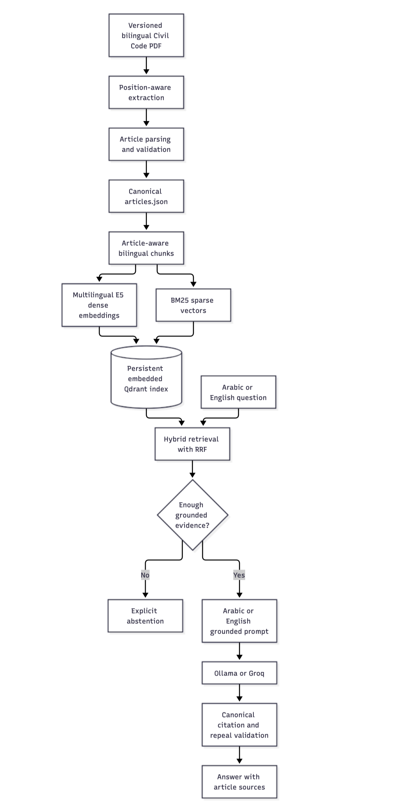
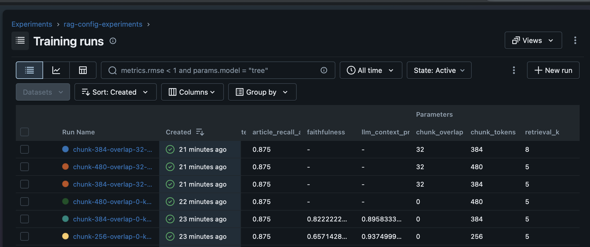

# Arabic Legal Document Q&A

## Project overview

Arabic Legal Document Q&A is a bilingual retrieval-augmented generation (RAG) service over the Egyptian Civil Code. It answers Arabic and English questions from a validated, versioned legal corpus, returns canonical article citations, discloses repeal status, and abstains when retrieved evidence is insufficient.

The project combines a reproducible PDF-to-vector-index pipeline with FastAPI and an MLOps/observability stack:

- Article-aware bilingual retrieval using multilingual E5 dense embeddings and BM25 sparse vectors.
- Ollama-first answer generation with Groq fallback.
- DVC/DagsHub data and index versioning.
- MLflow experiment tracking and RAG configuration registration.
- RAGAS evaluation and scheduled 50-question quality monitoring.
- Self-hosted Langfuse traces for `/ask` and monitoring requests.
- Prometheus alerts and a provisioned Grafana dashboard.
- GitHub Actions validation and Docker Hub publishing.

### Local service links

| Service | URL | Availability |
| --- | --- | --- |
| FastAPI | <http://localhost:8000> | Core stack |
| Swagger/OpenAPI | <http://localhost:8000/docs> | Core stack |
| Health | <http://localhost:8000/health> | Core stack |
| MLflow | <http://localhost:5000> | Core stack |
| Langfuse | <http://localhost:3000> | Langfuse profile |
| Grafana | <http://localhost:3001> | Monitoring profile |
| Prometheus | <http://localhost:9092> | Monitoring profile |
| Pushgateway | <http://localhost:9191> | Monitoring profile |

`/docs` is FastAPI's interactive developer interface for trying the API. The project does not currently include a separate end-user web application.

## Quickstart

### Prerequisites and one-time setup

Install Git, Docker with Compose v2, and [`uv`](https://docs.astral.sh/uv/). You also need access to the project's DagsHub DVC remote, a private `.env`, and either Ollama or a Groq API token.

```bash
cp -n .env.example .env

read -s 'DAGSHUB_TOKEN?DagsHub token: '
printf '\n'
uv sync --group dvc
uv run --group dvc dvc remote modify dagshub --local access_key_id "$DAGSHUB_TOKEN"
uv run --group dvc dvc remote modify dagshub --local secret_access_key "$DAGSHUB_TOKEN"
unset DAGSHUB_TOKEN
```

These credentials are written to ignored `.dvc/config.local`. If using Groq, set `GROQ_TOKEN` in `.env`. If using Ollama, start it and pull the configured model:

```bash
ollama pull qwen2.5:7b
```

### Three-command core setup

```bash
uv sync --group dvc
uv run --group dvc dvc pull -r dagshub
docker compose up --build -d --wait
```

Verify readiness and send a question:

```bash
curl -fsS http://localhost:8000/health

curl -fsS http://localhost:8000/ask \
  -H 'Content-Type: application/json' \
  -d '{"question":"ما آثار العقد؟"}'
```

The core setup starts FastAPI and MLflow. Langfuse and Grafana/Prometheus are optional overlays described later.

## Architecture

### RAG and data pipeline


The PDF is an input artifact, not the runtime retrieval source. `data/processed/articles.json` is canonical. Chunks, reports, and the Qdrant index are reproducible derivatives, and citations come from validated metadata rather than model-generated identifiers.

### System architecture

```text
                                     ┌──────────────────────────┐
 User or client ── HTTP :8000 ─────► │      FastAPI app         │
                                     │ /ask /health /metrics    │
                                     └────────────┬─────────────┘
                                                  │
                                                  ▼
                                     ┌──────────────────────────┐
                                     │     RAG orchestrator     │
                                     └─┬────────┬─────────────┬─┘
                                       │        │             │
                                       ▼        ▼             ▼
                              Embedded      ONNX E5      Model provider
                               Qdrant       embedder     ┌─────────────┐
                                                        │ Ollama host │
                                                        │      or     │
                                                        │  Groq API   │
                                                        └─────────────┘

 Optional integrations from the app

   Configuration ───────────────► MLflow :5000
   Request traces and spans ────► Langfuse :3000
   HTTP /metrics ───────────────► Prometheus :9092 ───► Grafana :3001

 Scheduled quality monitoring

   RAGAS monitor ──reads────────► Existing embedded Qdrant index
         │
         ├── runs and artifacts ► MLflow
         ├── traces and scores ─► Langfuse
         └── batch metrics ─────► Pushgateway :9191
                                           │
                                           ▼
                                   Prometheus ───► Grafana

 Reproducible delivery

   DVC + DagsHub ──restore artifacts──► Docker image build
                                               │
                                   ┌───────────┴───────────┐
                                   ▼                       ▼
                              FastAPI image          Monitor image
```

### `/ask` request flow

1. FastAPI validates the request and rejects blank questions.
2. The orchestrator detects whether the question is Arabic or English.
3. Qdrant performs dense and sparse retrieval using the original question.
4. The evidence gate abstains when too little grounded material is available.
5. The matching Arabic or English prompt sends only retrieved evidence to Ollama or Groq.
6. The response returns deduplicated canonical article citations, never chunk IDs.
7. When enabled, Langfuse records retrieval/generation spans and Prometheus collects HTTP metrics.

## Tools and services

| Tool or service | Role | Access |
| --- | --- | --- |
| FastAPI | Serves `/ask`, `/health`, and `/metrics`; publishes OpenAPI. | <http://localhost:8000>, Swagger at `/docs` |
| Qdrant | Stores the persistent hybrid dense/sparse index in embedded mode. | `data/vector_store/qdrant/`; no separate UI or port |
| ONNX Runtime + E5 | Runs multilingual embeddings on CPU without PyTorch weights. | Internal; cache in `data/model_cache/` |
| FastEmbed BM25 | Produces sparse vectors for hybrid retrieval. | Internal |
| Ollama | Preferred local chat provider in `auto` mode when available. | Normally <http://localhost:11434> |
| Groq | Hosted fallback or explicitly selected chat provider. | External API; configure `GROQ_TOKEN` |
| MLflow | Stores experiments, monitoring runs, and approved RAG config. | <http://localhost:5000> |
| RAGAS | Evaluates retrieval contexts and generated answers. | Evaluation and monitor CLIs |
| DVC + DagsHub | Versions the PDF, datasets, pipeline outputs, and index. | `.dvc/config`; credentials in `.dvc/config.local` |
| Langfuse | Stores traces, spans, generation metadata, and trace scores. | <http://localhost:3000> |
| Pushgateway | Receives metrics from the batch RAGAS monitor. | <http://localhost:9191> |
| Prometheus | Scrapes metrics and evaluates quality alert rules. | <http://localhost:9092> |
| Grafana | Displays the provisioned RAG quality dashboard. | <http://localhost:3001> |
| Docker Compose | Runs core and optional service overlays. | Root `compose*.yaml` files |
| GitHub Actions | Validates PRs and publishes Docker images on `main`. | `.github/workflows/ci-cd.yml` |

## Project structure

```text
.
├── .github/workflows/ci-cd.yml       # PR validation and Docker Hub publishing
├── .dvc/config                       # shared DagsHub remote, without credentials
├── data/
│   ├── raw/                          # DVC-tracked source PDF
│   ├── processed/                    # canonical corpus and extraction reports
│   ├── evaluation/                   # foundation/monitoring sets and local caches
│   ├── model_cache/                  # downloaded model artifacts
│   └── vector_store/qdrant/          # persistent index and manifest
├── monitoring/
│   ├── prometheus.yml                # scrape configuration
│   ├── prometheus-alerts.yml         # quality/drift/failure alert rules
│   └── grafana/                      # provisioned datasource and dashboard
├── notebooks/basic_rag.ipynb         # exploratory and educational experiments
├── reports/mlflow_runs_results.png   # captured MLflow result
├── src/
│   ├── api/                          # FastAPI lifecycle, routes, and schemas
│   ├── arabic_legal_qa/
│   │   ├── rag/                      # production extraction, index, retrieval,
│   │   │                             # prompting, generation, citations, and CLI
│   │   └── evaluation/               # MLflow runner, registry, RAGAS monitor
│   └── helpers/                      # config, logging, metrics, tracing, MLflow
├── tests/                            # deterministic unit and contract tests
├── Dockerfile                        # runtime and monitor image targets
├── compose.yaml                      # FastAPI and MLflow
├── compose.langfuse.yaml             # optional Langfuse infrastructure
├── compose.monitoring.yaml           # optional monitor/Prometheus/Grafana
├── dvc.yaml / dvc.lock                # corpus and index pipeline
├── pyproject.toml / uv.lock           # package and locked dependencies
└── .env.example                      # safe configuration template
```

Production behavior lives under `src/`. `src/arabic_legal_qa/rag/orchestrator.py` coordinates retrieval, evidence gating, prompting, generation, citations, and tracing. Neighboring modules implement extraction, chunking, embeddings, Qdrant indexing, and provider selection. `src/api/` is the HTTP boundary, `src/helpers/` owns shared configuration and observability, and `src/arabic_legal_qa/evaluation/` contains offline experiments and scheduled monitoring.


## Features and how to use them

### Ingestion and indexing

The ingestion flow first extracts and validates the PDF into the canonical JSON corpus, then builds the hybrid Qdrant index from that validated corpus.

Install the runtime package and the optional Ollama adapter when using the local model:

```bash
uv sync --extra ollama
```

Extract and validate the source PDF with the committed project defaults:

```bash
uv run python -m arabic_legal_qa.rag.pdf_loader \
  data/raw/egyptian_civil_law.pdf \
  data/processed \
  --project-defaults
```

The extraction command creates:

- `extraction_rows.json`: position-aware raw extraction rows.
- `article_candidates.json`: parsed candidates before canonical validation.
- `extraction_report.json`: source hash, corrections, and extraction details.
- `validation_status.json`: the corpus validation receipt.
- `articles.json`: canonical articles, written only after validation succeeds.

Build or replace the local Qdrant index from the validated `articles.json` with the public application CLI:

```bash
uv run arabic-legal-qa --root . ingest
```

The command prints a JSON ingestion summary and respects active runtime settings, including an approved MLflow configuration when available. Test the installed query path without starting FastAPI:

```bash
uv run arabic-legal-qa --root . query \
  "هل يجوز تعديل العقد من طرف واحد؟"

uv run arabic-legal-qa --root . query \
  "Can one party modify a contract alone?" \
  --k 8
```

Example canonical article schema:

```json
{
  "article_number": 2,
  "section": "SECTION I Laws and their Applications",
  "topic": "1. Laws and Rights",
  "text_ar": "لا يجوز إلغاء نص تشريعي إلا بتشريع لاحق ...",
  "text_en": "A provision of a law can only be repealed ...",
  "is_repealed": false,
  "source_page": 1,
  "citation": "Egyptian Civil Code, Article 2"
}
```

The source has a known defect around Article 1022. The extractor applies an explicit correction, records it in `extraction_report.json`, and validates 1,149 articles before writing canonical `articles.json`. Invalid corpora are not indexed.

### DVC versioning and reproducibility

DVC handles versioned inputs and reproducible pipeline outputs separately from the application CLI. Git stores pointers and pipeline metadata; the shared DagsHub remote stores the data objects.

These direct inputs have committed `.dvc` pointers:

- `data/raw/egyptian_civil_law.pdf`
- `data/evaluation/foundation_questions.json`
- `data/evaluation/monitoring_questions.json`

The pipeline has two stages:

| Stage | Purpose | Main outputs |
| --- | --- | --- |
| `build-corpus` | Extract, normalize, repair, and validate the PDF. | extraction rows, candidates, report, validation status, `articles.json` |
| `build-index` | Chunk and embed validated articles, then build Qdrant. | `data/vector_store/qdrant/` and manifest |

The `build-index` stage deliberately uses committed project defaults rather than developer-specific `.env` overrides. Use it when the required result is a reproducible index; use the application `ingest` command for runtime experiments with active settings.

Restore all artifacts referenced by the checked-out Git revision, then reproduce only stages whose dependencies changed:

```bash
uv run --group dvc dvc pull -r dagshub
uv run --group dvc dvc repro
```

`dvc repro` skips unchanged stages. Force the complete PDF-to-index pipeline or only indexing with:

```bash
uv run --group dvc dvc repro --force
uv run --group dvc dvc repro --force build-index
```

After intentionally changing a directly tracked dataset:

```bash
uv run --group dvc dvc add data/evaluation/foundation_questions.json
uv run --group dvc dvc push -r dagshub
git add data/evaluation/foundation_questions.json.dvc
```

When pipeline inputs or code change, reproduce the affected stages, push their objects, and commit the updated lock file:

```bash
uv run --group dvc dvc repro
uv run --group dvc dvc push -r dagshub
git add dvc.lock
```

Reproduce a historical result on another machine with:

```bash
git checkout <commit-or-tag>
uv run --group dvc dvc pull -r dagshub
uv run --group dvc dvc repro
```

Never commit `.dvc/config.local`, `.env`, API tokens, or restored data objects. Commit the `.dvc` pointers, shared `.dvc/config`, `dvc.yaml`, `dvc.lock`, pipeline code, and `uv.lock` whenever they change.

### API

| Method and path | Behavior |
| --- | --- |
| `POST /ask` | Answers a non-empty Arabic or English question with canonical citations. |
| `GET /health` | Returns readiness and indexed-document count; HTTP 503 includes errors. |
| `GET /metrics` | Returns Prometheus metrics; intentionally omitted from Swagger. |
| `GET /docs` | Opens interactive Swagger documentation. |

```bash
curl -fsS http://localhost:8000/ask \
  -H 'Content-Type: application/json' \
  -d '{"question":"Can a contract be modified by one party alone?"}'
```

```json
{
  "answer": "...",
  "sources": ["Egyptian Civil Code, Article 147"]
}
```

Blank questions and unknown fields return HTTP 422. Weak or out-of-corpus evidence yields an explicit abstention instead of an unsupported answer.

### Model providers and bilingual prompts

`LLM_PROVIDER=auto` probes Ollama once at startup and uses it when the configured model is present; otherwise it initializes Groq. Set `LLM_PROVIDER=ollama` to require Ollama or `LLM_PROVIDER=groq` to force Groq.

The orchestrator selects `ANSWER_PROMPT_AR` or `ANSWER_PROMPT_EN` from the question language. Both restrict generation to retrieved evidence. Retrieval itself remains bilingual and does not filter results to only the question's language.

Changing the embedding model, revision, vector size, or chunk settings requires rebuilding Qdrant. The manifest records corpus hash, model revision, chunk settings, and chunk digest.

### Docker and Compose

The `runtime` image target serves FastAPI and MLflow with different commands. The `monitor` target adds RAGAS dependencies. DVC artifacts are copied into the image, so pull them before building and rebuild after corpus/index changes.

Core stack:

```bash
docker compose up --build -d --wait
```

Complete local stack:

```bash
docker compose \
  -f compose.yaml \
  -f compose.langfuse.yaml \
  -f compose.monitoring.yaml \
  --profile langfuse \
  --profile monitoring \
  up --build -d --wait
```

Inspect and follow logs:

```bash
docker compose -f compose.yaml -f compose.langfuse.yaml -f compose.monitoring.yaml \
  --profile langfuse --profile monitoring ps
docker compose -f compose.yaml -f compose.langfuse.yaml -f compose.monitoring.yaml \
  --profile langfuse --profile monitoring logs -f app ragas-monitor
```

Stop without deleting named volumes:

```bash
docker compose -f compose.yaml -f compose.langfuse.yaml -f compose.monitoring.yaml \
  --profile langfuse --profile monitoring down
```

Do not add `-v` unless you intend to delete persisted MLflow, Langfuse, Prometheus, Grafana, and supporting-service data.

### MLflow and RAGAS experiments

The evaluator compares six RAG candidates:

| Run | Chunk tokens | Overlap | Retrieval `k` |
| --- | ---: | ---: | ---: |
| 1 | 256 | 0 | 5 |
| 2 | 384 | 0 | 5 |
| 3 | 480 | 0 | 5 |
| 4 | 384 | 32 | 5 |
| 5 | 480 | 32 | 5 |
| 6 | 384 | 32 | 8 |

All runs get deterministic article hit-rate and recall. Only retrieval leaders generate answers and invoke RAGAS, reducing calls. Quick mode uses up to four balanced development questions; full mode uses the full development split.

```bash
uv sync --extra evaluation --group test
MLFLOW_TRACKING_URI=http://127.0.0.1:5000 \
  uv run --extra evaluation arabic-legal-qa-evaluate \
  --mode quick --finalists 2 --judge-workers 1
```

Core judging logs faithfulness and context precision. `--judge-metrics all` adds context utilization and answer relevance. Use `--no-promote` to prevent registry changes and `--no-cache` to recompute cached stages.

The winner is registered as `arabic-legal-rag-config` with alias `champion` only after meeting `MLFLOW_MIN_FAITHFULNESS`. Validate it on held-out data without promotion:

```bash
uv run --extra evaluation arabic-legal-qa-evaluate --validate-champion
```

Open <http://localhost:5000> and select `rag-config-experiments`. Before a champion exists, the app warns and uses centralized defaults unless `MLFLOW_CONFIG_REQUIRED=true`.

### Langfuse tracing

```bash
docker compose -f compose.yaml -f compose.langfuse.yaml \
  --profile langfuse up --build -d --wait
```

Open <http://localhost:3000>, create the initial local account/project and API keys, then add `LANGFUSE_PUBLIC_KEY` and `LANGFUSE_SECRET_KEY` to `.env` and recreate the app:

```bash
docker compose -f compose.yaml -f compose.langfuse.yaml \
  --profile langfuse up -d --force-recreate app
```

Every `/ask` creates retrieval and generation spans. Monitoring traces also receive `ragas_faithfulness`. `LANGFUSE_CAPTURE_CONTENT=false` is the safe default; `true` includes questions, contexts, prompts, and answers.

### Prometheus, Grafana, and RAGAS monitoring

The DVC-tracked monitoring set contains 50 bilingual questions. Each session reads the existing index without re-indexing, generates answers, computes context precision, faithfulness, context recall, and answer correctness, logs aggregate and per-question results to MLflow, attaches faithfulness to Langfuse traces, and exports metrics through Pushgateway.

The container runs immediately and repeats every `RAGAS_MONITOR_INTERVAL_HOURS` (default 24). Run a one-off session with services already running:

```bash
docker compose -f compose.yaml -f compose.langfuse.yaml -f compose.monitoring.yaml \
  --profile langfuse --profile monitoring \
  run --rm --no-deps ragas-monitor arabic-legal-qa-monitor
```

Open Grafana at <http://localhost:3001> and select **Arabic Legal RAG Quality**. The username defaults to `admin`; the password is `GRAFANA_ADMIN_PASSWORD`.

Prometheus rules fire when faithfulness is below `0.80`, comparable-run faithfulness falls by at least `0.10`, monitoring fails, or monitoring becomes stale. The repository does not include an Alertmanager receiver, so email/Slack/webhook delivery needs separate configuration.

### GitHub Actions CI/CD

`.github/workflows/ci-cd.yml` runs on pull requests targeting `main` and pushes to `main`.

The `validate` job checks out code, installs locked dependencies, restores/verifies DVC artifacts, runs basic Ruff lint/format checks, runs pytest, and builds the Docker image without publishing it. After validation succeeds on a push to `main`, `publish` logs in to Docker Hub and pushes `:main` plus `:sha-<git-sha>` tags.

| GitHub setting | Type | Purpose |
| --- | --- | --- |
| `DAGSHUB_TOKEN` | Repository secret | Restore DVC data. |
| `DOCKERHUB_USERNAME` | Repository variable | Docker Hub namespace. |
| `DOCKERHUB_TOKEN` | Repository secret | Push images with read/write access. |

Fork pull requests do not receive repository secrets, so DVC-dependent validation is intended for trusted branches or pull requests.

## Results and screenshots

### MLflow configuration comparison



Use these live views as project evidence:

| Result | Location | Evidence to capture |
| --- | --- | --- |
| API behavior | FastAPI `/docs` | `/ask`, sources, rejection, and `/health`. |
| Config evaluation | MLflow `rag-config-experiments` | Six retrieval runs and finalist RAGAS metrics. |
| Quality trends | MLflow `rag-50-question-monitoring` | Multiple sessions with all four RAGAS metrics. |
| Request tracing | Langfuse Traces | `/ask` retrieval and generation spans. |
| Per-trace score | Langfuse trace scores | `ragas_faithfulness`. |
| Drift/alerts | Grafana RAG Quality | Metric history and alert state. |

Store new documentation screenshots under `docs/images/` and redact tokens, email addresses, usernames, and sensitive questions before committing them.

## Configuration and secrets

Copy `.env.example` to `.env`. Important settings are:

| Variable | Purpose | Default/requirement |
| --- | --- | --- |
| `LLM_PROVIDER` | Select `auto`, `ollama`, or `groq`. | `auto` |
| `OLLAMA_MODEL` | Local model to probe/use. | `qwen2.5:7b` |
| `OLLAMA_BASE_URL` | Ollama endpoint. | Compose uses Docker host |
| `GROQ_TOKEN` | Groq authentication. | Required when Groq is used |
| `MLFLOW_TRACKING_URI` | MLflow endpoint for local commands. | Compose injects internal URI |
| `MLFLOW_CONFIG_MODEL` | Registered config model. | `arabic-legal-rag-config` |
| `MLFLOW_CONFIG_ALIAS` | Approved config alias. | `champion` |
| `MLFLOW_CONFIG_REQUIRED` | Fail rather than use defaults when absent. | `false` |
| `MLFLOW_MIN_FAITHFULNESS` | Promotion threshold. | `0.75` |
| `LANGFUSE_PUBLIC_KEY` | Langfuse project public key. | Required for tracing |
| `LANGFUSE_SECRET_KEY` | Langfuse project secret. | Required for tracing |
| `LANGFUSE_CAPTURE_CONTENT` | Include questions/prompts/answers in traces. | `false` |
| `RAGAS_MONITOR_INTERVAL_HOURS` | Scheduled interval. | `24` |
| `RAGAS_FAITHFULNESS_THRESHOLD` | Low-quality alert. | `0.80` |
| `RAGAS_DRIFT_THRESHOLD` | Faithfulness decrease treated as drift. | `0.10` |
| `GRAFANA_ADMIN_USER` | Local Grafana admin. | `admin` |
| `GRAFANA_ADMIN_PASSWORD` | Local Grafana password. | Replace dev default outside local use |

Keep DagsHub credentials in `.dvc/config.local`, not `.env`. Keep Docker Hub credentials in GitHub Actions settings. Never commit `.env`, `.dvc/config.local`, or real tokens. Langfuse infrastructure passwords in Compose have fixed local-development defaults and must not be exposed or reused in production.

## Development and quality checks

```bash
uv sync --locked \
  --group dvc --group lint --group test \
  --extra ollama --extra evaluation

uv run --no-sync --group lint ruff check src tests
uv run --no-sync --group lint ruff format --check src tests
uv run --no-sync --group test pytest -q
```

Ruff is deliberately configured for basic checks (`E4`, `E7`, `E9`, and `F`); it is not used for logic-changing rewrites.

Quick evaluation smoke test:

```bash
MLFLOW_TRACKING_URI=http://127.0.0.1:5000 \
  uv run --extra evaluation arabic-legal-qa-evaluate \
  --mode quick --finalists 1 --judge-workers 1 --no-promote
```

Deterministic tests use local fakes where practical. DVC restore, Docker builds, live MLflow/Langfuse integration, provider generation, and RAGAS judging require their corresponding data, services, credentials, or network access.


## Current limitations

- No vLLM service is included; Ollama is the preferred local provider, and Groq is the fallback.
- No quantization or GPU acceleration is currently implemented for the LLM.
- Swagger is available for developers, but there is no dedicated end-user UI.
- Alert rules exist, but external notification delivery requires an Alertmanager receiver.
